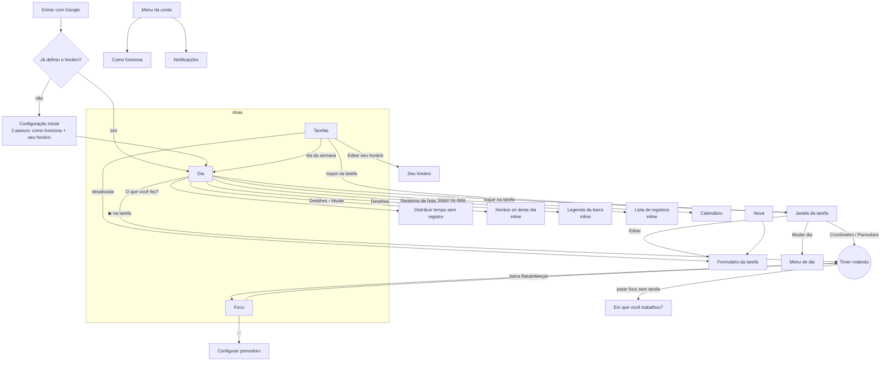

# 2. Navegação

## Estrutura

São **3 abas** e um botão de criar:

| | Celular (barra de baixo) | Computador (barra lateral) |
|---|---|---|
| **Dia** | 1º item | 1º item |
| **Tarefas** | 2º item | 2º item |
| **Nova** (criar tarefa) | 3º item | botão azul no topo |
| **Foco** | 4º item | 3º item |
| Menu da conta (notificações, Como funciona, Sair) | avatar no cabeçalho | nome no rodapé da barra |
| Recolher barra | – | rodapé da barra |

A aba fica no endereço (`#tarefas`, `#foco`). Recarregar mantém a aba e o "voltar" do celular volta para a aba anterior. O dia escolhido na tela Dia volta para hoje ao recarregar.

Por cima de tudo podem aparecer:

- **Barra do timer** (flutuante), quando há timer rodando e você não está em Foco.
- **Avisos no rodapé** (toasts): tempo registrado, ações com **Desfazer**, erro ao salvar, avisos de início e fim de horário.
- **Sem internet** no topo, quando a conexão cai.

## Mapa de telas e janelas

## Por onde se chega em cada coisa

| Quero… | Caminhos |
|---|---|
| Criar tarefa | **Nova** · campo "Nova tarefa" no Dia · campos de criação rápida em Tarefas (Repetem / Não repetem) |
| Editar tarefa | toque na tarefa (Dia ou Tarefas) › **Editar** no cabeçalho da janela |
| Mudar só o tempo | Tarefas › toque no tempo (ex: "1h") |
| Mudar só a data | janela da tarefa › **Mudar dia** · Tarefas › toque na data · Dia › aviso de atrasadas › Trazer para hoje · Dia › "Como dar tempo" › Amanhã |
| Mudar os dias de uma que repete | Tarefas › botões Seg…Dom da linha · formulário |
| Começar timer | ▶ na linha (último modo usado) · janela da tarefa (Cronômetro ou Pomodoro) · Foco › Começar |
| Parar timer | ■ na linha · barra flutuante · janela da tarefa · Foco |
| Ajustar hora de início do timer | "Começou às… · Mudar" na barra flutuante, janela da tarefa ou Foco |
| Adicionar tempo já feito | janela da tarefa › Adicionar tempo já feito · Dia › O que você fez? |
| Ver/editar registros | Dia › **Registros de hoje** (todas as tarefas) · janela da tarefa › Registros (histórico da tarefa) · Foco › Hoje · Xh registrados |
| Dar tarefa a um registro sem tarefa | Registros de hoje › **Escolher tarefa** |
| Desfazer | **Desfazer** no aviso do rodapé, logo depois da ação |
| Concluir | círculo na linha · janela da tarefa › Concluir |
| Pular hoje | janela da tarefa · Dia › "Como dar tempo" |
| Desativar / reativar tarefa que repete | formulário › Desativar · Tarefas › Desativadas › Reativar |
| Excluir tarefa | formulário › Excluir |
| Mudar seu horário | Tarefas › Seu horário |
| Mudar horário só de hoje | Dia › Detalhes (ou toque na legenda) › Mudar |
| Configurar pomodoro | Foco › ··· |
| Permitir notificações | **Menu da conta › Notificações › Ativar** · Foco › ··· · formulário › com horário |
| Ver outro dia | Dia › setas ‹ › · **toque na data** (calendário) · Tarefas › Esta semana › toque no dia · "Hoje" para voltar |
| Ver a semana | Tarefas › **Esta semana** / Próxima |
| Reabrir tarefa concluída | Tarefas › Não repetem › Concluídas · últimos 7 dias › Reabrir · Dia › Concluídas › círculo |
| Como funciona / Sair | menu da conta |
