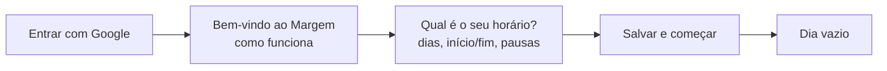
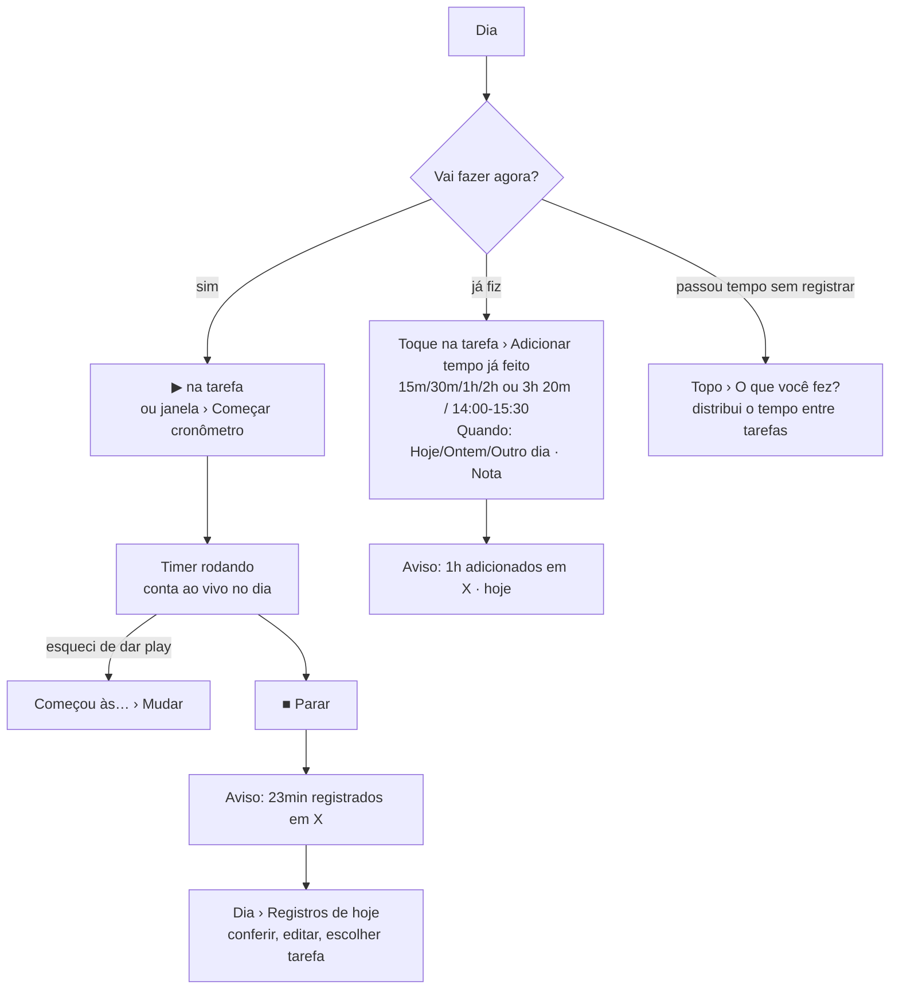
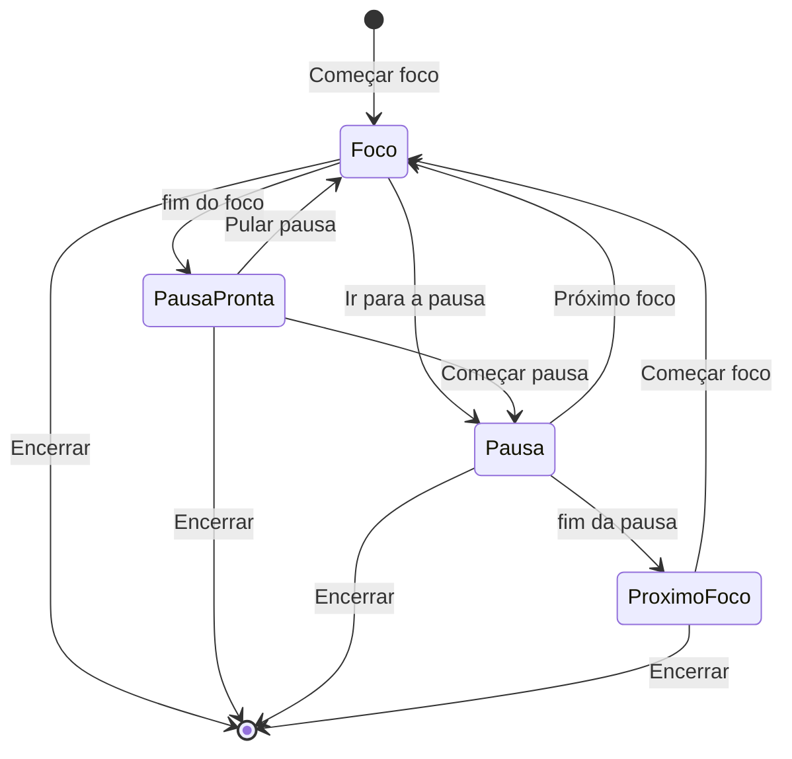

# 3. Fluxos

Cada fluxo tem o caminho principal e as variações. Os nomes de botões estão como aparecem na tela.

## 3.1 Primeiro acesso

1. **Entrar com Google** (tela de entrada, com o resumo "Como funciona").
2. Janela **Bem-vindo ao Margem**: os 3 passos do app e a régua de exemplo. **Continuar**.
3. **Qual é o seu horário?**: marca os dias, escolhe início e fim de cada um, e as pausas fixas (almoço vem pronto). Atalho "Repetir segunda até sexta". **Salvar e começar**.
4. Fechar a janela (X ou fora dela) pula a configuração e mantém o horário padrão (seg a sex, 08–18, almoço 12–13).
5. Cai no **Dia**, sem tarefas: "Nenhuma tarefa neste dia. Adicione acima ou pelo botão Nova tarefa."

 

## 3.2 Montar a rotina (tarefas que repetem)

1. **Tarefas** › campo "Nova que repete, ex: Academia 1h" › Enter.
   - Com tempo no fim ("Academia 1h"): cria direto, nos dias que têm horário.
   - Sem tempo ("Academia"): abre o formulário para completar.
2. Ajustar os dias tocando em **Seg…Dom** na linha (não deixa ficar sem nenhum dia).
3. Ajustar o tempo tocando nele ("1h") e digitando ("1h30"), Enter.
4. Para horário fixo ou "cumpro o tempo": toque na tarefa › **Editar** › **Mais opções**.
5. Conferir **Esta semana** no topo de Tarefas: quanto sobra (verde) ou falta (vermelho) em cada dia, já contando as tarefas de uma vez. Tocar num dia abre o Dia naquela data.

## 3.3 Criar uma tarefa de uma vez

| Por onde | Dia que recebe | Sem tempo informado |
|---|---|---|
| **Nova** (barra/botão) | o dia aberto no Dia | abre o formulário (tempo obrigatório) |
| Dia › "Nova tarefa, ex: Revisar PR 45m" | o dia aberto | abre o formulário |
| Tarefas › "Nova para hoje, ex: Revisar PR 45m" | hoje | abre o formulário |

Formulário: Nome · Uma vez / Repete · dia (Hoje · Amanhã · Outro dia) · Quanto tempo leva · Mais opções (horário, como termina). **Criar**.

## 3.4 Durante o dia: registrar tempo

Regras:

- O ▶ usa o último modo usado (cronômetro por padrão).
- Parar com menos de 1 minuto não registra ("Menos de 1 minuto: não foi registrado").
- Começar timer em outra tarefa encerra e registra o anterior.
- O cronômetro sempre tem uma tarefa. Registros antigos sem tarefa ainda podem ser ligados em Registros de hoje › Escolher tarefa.
- Quer o ritmo do pomodoro? Use o Foco junto: o pomodoro avisa as pausas e o cronômetro continua registrando.
- Na janela da tarefa, "Adicionar tempo já feito" fica recolhido num botão.
- O horário de início ajustado tem que ser de hoje e não pode ser no futuro.

## 3.5 Concluir, pular, encurtar

| Ação | Onde | Efeito |
|---|---|---|
| Concluir | círculo na linha · janela › Concluir | sai da lista (vai para "Concluídas"); o que faltava volta para a sobra |
| Concluir tarefa "cumpro o tempo" | automático | conclui quando o registrado chega na meta (ícone de alvo em vez de círculo) |
| Pular hoje | janela › Pular hoje · "Como dar tempo" | só tarefas que repetem; sai da conta do dia; desfazer na janela |
| Encurtar para X | "Como dar tempo" (tarefas "cumpro o tempo") | tempo só de hoje; "Voltar ao normal" na janela |
| Amanhã | "Como dar tempo" (tarefas de uma vez) | muda a data para o dia seguinte |
| Mudar dia | janela da tarefa de uma vez | Hoje, Amanhã, Próxima segunda ou Outro dia; aviso "X foi para amanhã" |

## 3.6 Dia apertado ("Não dá tempo")

1. O topo fica vermelho: **Não dá tempo: 43min a mais** e a barra mostra o vermelho depois da marca do fim do horário.
2. Tocando em **Como dar tempo** abre "Tire 43min de hoje com um destes:", com até 4 tarefas (primeiro as sem horário, as maiores antes) e a ação de cada uma: **Pular hoje**, **Amanhã** ou **Encurtar para…**.
3. Se houver tempo sem registro, **O que você fez?** costuma resolver parte do aperto, porque o que foi feito e não registrado ainda conta como "falta".

## 3.7 Tarefas atrasadas

1. Tarefas de uma vez de dias anteriores, não concluídas, aparecem no Dia (só hoje) como aviso: **2 tarefas ficaram de dias anteriores · 1h05**.
2. **Trazer para hoje** muda a data de todas; abrindo o aviso, **Hoje** traz uma por vez.
3. Em Tarefas, elas aparecem no grupo **Atrasadas**, com a data em vermelho.

## 3.8 Pomodoro (só ritmo, não registra)

- Com **Pausas automáticas** ligado, "Pausa pronta" vira "Pausa" direto. Com **Início de foco automático**, "Próximo foco" vira "Foco" direto. Os dois vêm desligados.
- **O pomodoro não grava tempo.** Quem registra é o cronômetro, que pode rodar ao mesmo tempo (ex: cronômetro em "Trabalho" das 9h às 12h, com pomodoros por cima; a pausa conta porque o cronômetro não para). Para não contar a pausa, pare o cronômetro nela.
- Com o app fechado, as fases continuam do ponto certo ao abrir (a próxima começa no fim da anterior); vários aparelhos abertos chegam ao mesmo estado.
- Avisos (notificação, se permitida, e bipe) no fim do foco e da pausa.

## 3.9 Horário da tarefa e avisos

1. Formulário › Mais opções › **Adicionar horário** (pode ter vários: 08–11 e 14–18). O tempo da tarefa vira a soma dos horários (dá para mudar).
2. Com o app aberto, no horário: "Trabalho começa agora (08:00–11:00)", "Trabalho: pausa até as 14:00", "Trabalho recomeça agora (14:00–18:00)", "Trabalho terminou por hoje".
3. Conflito com outra tarefa nos próximos 14 dias aparece como aviso no formulário (não impede salvar) e na linha do Dia.

## 3.10 Mudar o horário

- **De sempre**: Tarefas › Seu horário › Editar › dias, início/fim, pausas › Salvar.
- **Só de um dia**: Dia › Detalhes › Mudar › início/fim › Salvar · ou **Sem horário** · ou **Voltar ao padrão**.

## 3.11 Organizar e limpar

- **Desativar** (tarefas que repetem): toque na tarefa › Editar › Desativar. Some dos dias e vai para Tarefas › Desativadas › Reativar.
- **Excluir**: formulário › Excluir (confirmação do navegador). Os registros continuam.
- **Buscar**: Tarefas › Buscar tarefa (ignora acentos).

## 3.12 Desfazer e erros

- Toda ação que tira ou move algo mostra um aviso no rodapé com **Desfazer** por 6 segundos: concluir, pular, mudar dia, amanhã, encurtar, trazer para hoje, apagar registro, adicionar tempo, "O que você fez?", desativar e excluir tarefa.
- Excluir tarefa não pede confirmação: some na hora e o Desfazer a recria igual. Os registros dela nunca são apagados.
- Se uma gravação falhar, aparece o aviso vermelho "Não foi possível salvar. Confira a internet e tente de novo."
- Sem internet, o app continua funcionando com o que já tinha carregado. As mudanças ficam no aparelho e são enviadas quando a conexão voltar ("Sem internet · salva quando voltar" no topo).

## 3.13 Notificações

- O app não pede permissão sozinho. O lugar fixo é o **menu da conta › Notificações › Ativar**. Também dá para ativar em Foco › ··· e no formulário de uma tarefa com horário.
- Se a permissão foi negada, o menu explica que é preciso liberar nas configurações do navegador para o site.
