# 4. Telas e opções

Referência de cada tela e janela, de cima para baixo. Arquivo do código entre parênteses. Imagens geradas pela prévia (`/dev`) com dados de exemplo.

---

## Páginas públicas (`src/app/page.tsx`, `privacidade/`, `termos/`, `_site/`)

Renderizadas no servidor. O app fica em **`/app`**.

| Página | Conteúdo |
|---|---|
| `/` Página de vendas | Promessa ("Saiba todo dia quanto tempo sobra para estudar"), **Começar grátis** (→ `/app`), 4 recursos, "Comece em 2 minutos", preços Grátis × Pro, dúvidas, rodapé com Privacidade e Termos. Quem já entrou é mandado para `/app` (marca `margem.entrou` no navegador); `/?site` mostra a página mesmo assim |
| `/privacidade` | Política de privacidade (LGPD): dados, finalidades e base legal, onde ficam, prazo, direitos e como exercer no app |
| `/termos` | Termos de uso: planos, teste de 14 dias, renovação, cancelamento, arrependimento de 7 dias, foro |

Responsável, e-mail de contato e preços ficam em `src/lib/legal.ts`.

## Entrar (`App.tsx`)

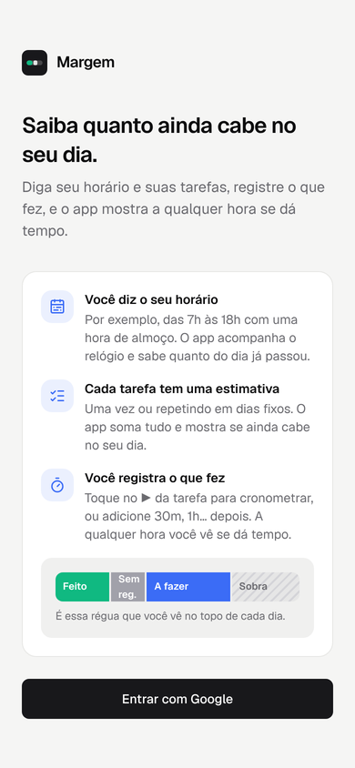

- "Saiba quanto ainda cabe no seu dia." + "Diga seu horário e suas tarefas, registre o que fez, e o app mostra a qualquer hora se dá tempo."
- Resumo **Como funciona** (3 passos e régua de exemplo) e **Entrar com Google**. Erro de domínio não autorizado aparece embaixo do botão.
- Embaixo: "Ao entrar, você concorda com os termos de uso e a política de privacidade" e **Conhecer o Margem** (→ `/?site`).
- Enquanto carrega, um esqueleto da tela (sem texto "Carregando…").

## Configuração inicial (`Onboarding.tsx`)

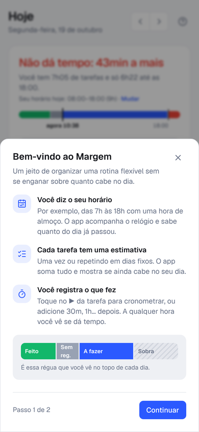

Aparece enquanto o horário não foi definido.

| Passo | Conteúdo | Ações |
|---|---|---|
| 1. Bem-vindo ao Margem | Como funciona | Continuar |
| 2. Qual é o seu horário? | Editor de horário (igual ao de Tarefas) | Voltar · Continuar |
| 3. Sua rotina (só conta sem tarefas) | **Trabalho** (liga/desliga, 4h · 6h · 8h por dia, seg a sex, "cumpro o tempo") e **O que você quer encaixar** (nome, Seg a sex · Seg a sáb · Todos os dias, 30min · 1h · 1h30 · 2h, "Meta da semana: 5h") | Voltar · Salvar e começar (cria as tarefas) |

Fechar (X, Esc ou fora) pula e mantém o horário padrão.

---

## Cabeçalho e navegação (`App.tsx`, `AccountMenu.tsx`)

| Elemento | Celular | Computador |
|---|---|---|
| Título e data | "Hoje" / dia da semana; **tocar na data abre o calendário** (só no Dia) | igual |
| Setas ‹ › e **Hoje** | no Dia | no Dia |
| Menu da conta | avatar no canto do cabeçalho | nome no rodapé da barra lateral |
| Abas | barra de baixo: Dia · Depois · **Nova** · Tarefas · Foco | barra lateral: **Nova tarefa** · Dia · Depois · Tarefas · Foco · Recolher |

**Menu da conta**

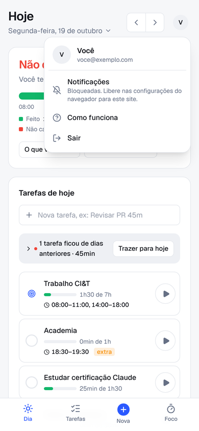

- Nome e e-mail.
- **Notificações**: ativadas / "Ativar" / bloqueadas no navegador (com instrução) / não suportadas. É o lugar fixo para ligar os avisos.
- **Ponto do trabalho**: abre a Jornada do ponto (ou o Transformar em ponto).
- **Google Agenda** (`Agenda.tsx`): explica o que conta e o que não conta, **Conectar Google Agenda** (janela do Google, só leitura) ou **Desconectar**.
- **Registrar tempo** (chave): ligado = cronômetro em cada tarefa, "Sem registro", "O que você fez?", "Esta semana", encaixe e "Suas estimativas". Desligado (**modo leve**) = só as tarefas "Cumpro o tempo" têm ▶; o topo do Dia mostra "Já passou" no lugar de "Sem registro", e o dia encerrado mostra "4 de 6 tarefas feitas". Contas antigas começam ligadas; contas novas, desligadas. No modo leve, tarefa "Cumpro o tempo" com horário vira **bloco reservado**: na lista, relógio no lugar do círculo, "horário reservado", sem ▶ nem progresso, **Agora** enquanto acontece; no topo, "Xh livres, fora de Trabalho, até as 18:00".
- **Plano** (só com a cobrança ligada): "Pro grátis · faltam N dias · Assinar", "Plano grátis · Conhecer o Pro" ou "Assinatura Pro · Ver ou cancelar".
- **Seus dados**: **Baixar arquivo** (tudo da conta em JSON) e **Excluir conta…** (confirmação, pede o Google de novo, apaga tudo e volta para a página de vendas).
- **Como funciona**, **Sair** e os links Privacidade · Termos.

**Assinar** (`Pro.tsx`): Anual (R$ 79) ou Mensal (R$ 9,90), texto de renovação e reembolso, **Assinar** abre o pagamento do Mercado Pago. Ao voltar (`/app?assinatura=ok`), confirma e avisa. **Assinatura Pro**: plano, próxima cobrança ou até quando vale, **Cancelar assinatura** (confirmação).

---

## Dia (`views.tsx`, `CapacityPanel.tsx`, `DaySidebar.tsx`, `TaskRow.tsx`)

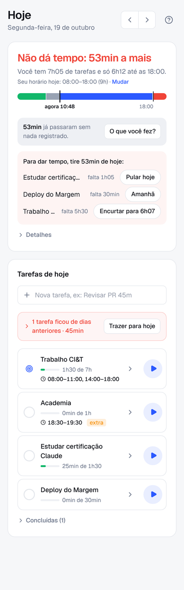 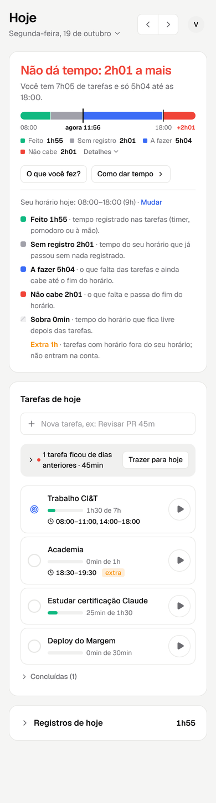

No computador, duas colunas: o topo do dia fica parado à esquerda e as tarefas e os registros rolam à direita.

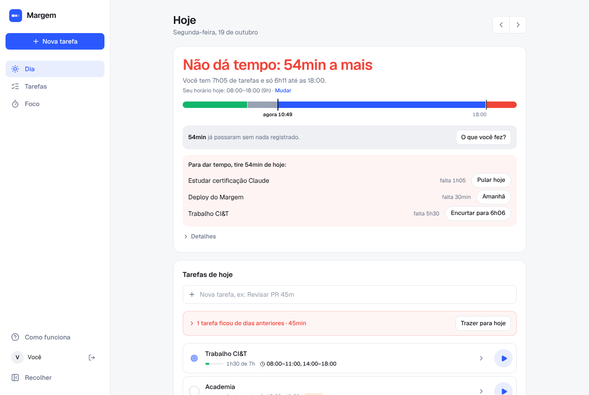

**Agenda** (`Agenda.tsx`, só com Google Agenda conectado): compromissos do dia em ordem (dia inteiro primeiro, os que já passaram riscados), total que saiu do tempo livre e ↻ para ler de novo. "livre" = marcado como Disponível no Google (não desconta). Se o acesso cair, "Conectar de novo". No computador fica embaixo do topo do dia; no celular, depois das tarefas. O texto do topo vira "Xh livres, fora do trabalho e dos compromissos, até as 23:00".

**Topo do dia**

| Elemento | Detalhe |
|---|---|
| Título | Dá tempo: sobram X · Não dá tempo: X a mais · X feitos (dia encerrado) · Hoje sem horário |
| Frase | "Você tem 2h30 de tarefas e só 44min até as 18:00." (+ "Horário só hoje." se o horário do dia foi alterado) |
| Barra (linha do tempo) | início, **agora** e fim do horário marcados; verde = feito, cinza = sem registro, azul = a fazer, hachurado = sobra, vermelho depois do fim = não cabe |
| Legenda | sempre visível embaixo da barra, só com as partes que existem: "Feito 1h55 · Sem registro 1h16 · A fazer 5h · Não cabe 1h · Sobra 30min" · **Detalhes ›**. Tocar abre os detalhes |
| Botões | **O que você fez?** (com 5min ou mais sem registro e alguma tarefa no dia) · **Como dar tempo** (quando não dá tempo) |
| Como dar tempo | recolhido; abre "Tire X de hoje com um destes:" e até 4 tarefas com **Pular hoje** / **Amanhã** / **Encurtar para X**, cada uma com Desfazer |
| Detalhes | recolhido; "Seu horário hoje: 08:00–18:00 (9h) · **Mudar**" (início, fim, Salvar, Sem horário, Voltar ao padrão, Cancelar) e a explicação de cada cor, com o total "extra". Em dia sem horário o botão é "Mudar horário deste dia" |

**Ponto** (`Ponto.tsx`; só com ponto ligado, hoje; acima do topo do dia)

| Elemento | Detalhe |
|---|---|
| Título | "Jornada de 7h · entrada às 08:00" / "Trabalhando · 6h23 de 7h" / "Em pausa · 4h de 7h" / "Trabalho encerrado · 7h05" / "Hoje não é dia de trabalho" |
| Linha | "Saída prevista 16:03 · faltam 37min"; encerrado: "Jornada cumprida" ou "30min a mais/a menos que a jornada" |
| Marcações | "08:05 · 12:02 · 13:00 ✎" abre **Marcações do dia** (Entrada/Saída alternadas, horário, apagar, + Entrada/Saída, "Já encerrei o trabalho hoje", Salvar com Desfazer). Sem marcação: **Esqueci de marcar** |
| Botões | **Entrar** (abre o Planejar o dia se ainda não planejou) · **Pausar** e **Sair** · **Voltar** e **Encerrar o dia** · encerrado: **Voltar ao trabalho**. Tudo com Desfazer |
| ⚙ | **Jornada do ponto**: dias, jornada por dia, entrada de costume, Seu dia (início e fim), **Desligar o ponto** |
| Rodapé | "Semana: 20h54 de 35h · saldo +30min" (saldo só dos dias fechados, desde que o ponto começou) |

**Separe o trabalho num ponto** (convite, uma vez, quando há uma tarefa "Cumpro o tempo" que repete): **Transformar em ponto** abre a mesma janela, com a jornada tirada da tarefa e o Seu dia sugerido em 07–23; **Agora não**.

Com ponto, o topo do dia diz "Xh livres, fora do trabalho, até as 23:00" e a fila começa depois do trabalho (ou antes dele).

**Tarefas de hoje**

| Elemento | Detalhe |
|---|---|
| Campo "Nova tarefa, ex: Revisar PR 45m" | Enter cria no dia aberto. Um dia no fim manda para ele ("amanhã", "sexta", "dia 10", "15/11"). Sem tempo, aparecem **15min · 30min · 1h · 2h · Lembrete · Depois** (um toque); Enter abre o formulário completo |
| **Planeje o dia (2 min)** | hoje, com horário ainda por vir, até escolher **Planejar** › **Pronto** ou **Agora não**. Depois disso, o botão **Planejar** fica no título da lista. Janela: veredito ao vivo ("Dá tempo: sobram 40min" / "Passou 1h: tire algo"), "Hoje · na ordem da fila" com **Tirar** (vai para Depois) ou **Pular hoje**, lembretes de hoje, "Em Depois" com **Hoje** (sem tempo, pede 15min/30min/1h/2h/Lembrete), **Pronto** |
| **Feche o dia (1 min)** | hoje, depois do fim do horário, até fechar. Janela: "Hoje: planejado 9h, feito 7h40" (modo leve: "4 de 6 tarefas feitas"), o que sobrou (de uma vez) com **Amanhã** · **Depois** · **Excluir**, "Amanhã já começa com 3 tarefas e 4h20" (vermelho se passa do horário), **Fechar o dia** grava a fotografia do dia |
| Lembretes do dia | tarefas de uma vez sem tempo: círculo, 🔔, nome, **Depois**. Fora da fila e das contas |
| Fechamento (tarefas de dias anteriores) | só hoje: "N tarefas ficaram de dias anteriores · Xh" · **Trazer para hoje** (com Desfazer). Aberto por padrão com até 3 tarefas: "Ontem: planejado 9h, feito 7h40" (fotografia do dia) e, em cada tarefa, **Hoje** · 📅 (Amanhã, Próxima segunda, Outro dia, com quanto sobra em cada) · 🗑 Excluir (com Desfazer). Também **Depois** (📥) em cada uma. Trazida para hoje entra no fim da fila |
| Linha da tarefa | círculo (concluir, com Desfazer) ou alvo (tarefa "cumpro o tempo") · nome (até 2 linhas) · progresso · horário · "☑ 1/3" (objetivos do dia) · "● 12:03" se o timer está nela · "extra" · conflito · **▶ / ■** (contorno cinza; azul só com o timer rodando) |
| Toque na linha | abre a **Janela da tarefa** |
| Fila | a ordem é sua: menu **⋮** na linha (**Fazer agora**, **Subir**, **Descer**) ou arrastar no computador. Sem fila salva, vale a ordem automática (com horário pela hora, depois pela criação); tarefa nova entra no fim. Tarefa com horário ainda por vir e as "extra" não mudam de lugar (sem ⋮) |
| Previsão | hoje e dias futuros: cada tarefa mostra o horário previsto ("11:35–13:05"), a partir de agora, pulando pausas e os horários das fixas, recalculado a cada minuto (arredondado de 5 em 5). A primeira ganha **Agora** (ou **Próxima**, se agora é pausa). Cabe só em parte: "13:50 · 55min não cabe" em vermelho. A lista aparece na ordem dos horários previstos; o cronômetro rodando vem primeiro |
| Não cabe hoje | linha vermelha antes das tarefas que não cabem nada, com o total delas; abaixo dela as linhas ficam apagadas |
| Concluídas / Puladas | recolhido no fim |
| Dia vazio | "Nenhuma tarefa neste dia." com **Criar tarefa** e **Montar rotina em Tarefas** |

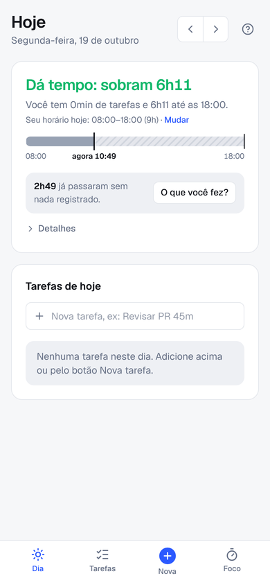 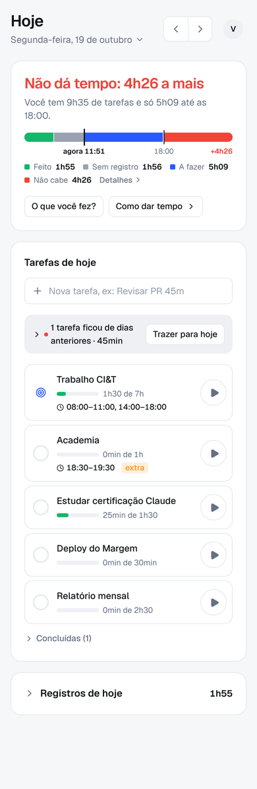

**Suas estimativas** (Pro; embaixo de "Esta semana"): só com 10 ou mais tarefas concluídas pelo círculo com tempo registrado nos últimos 28 dias. "Você costuma levar 1,2× o que estima. Uma tarefa de 1h vira 1h11." (ou "Você acerta o tempo", até 10% de diferença). No campo "Nova tarefa", a dica "Costuma levar ~1h". Na janela da tarefa concluída: "Estimado 45min · levou 1h05".

**Encaixe** (Pro, no topo do dia, só hoje e quando dá tempo): "Sobram 40min hoje: dá para recuperar 40min de Estudar." · **Começar** (cronômetro). Usa a tarefa mais atrasada na semana que não tem horário fixo.

**Esta semana** (Pro; no computador embaixo do topo do dia, no celular depois das tarefas)

| Elemento | Detalhe |
|---|---|
| Linha por tarefa que repete | nome, "3h25 de 9h" (registrado de planejado na semana), barra (laranja se atrasada), "1h30 atrasado" · "em dia" · "semana cumprida" |
| Fim de semana | "Para fechar a semana faltam 4h até domingo." |
| Toque na linha | janela **Constância**: dias seguidos, esta semana, dia a dia (verde cumprido, laranja ficou para trás), "1h30 ficaram para trás" · **Recuperar** (começa o timer), últimas 5 semanas |
| No grátis | cartão "Esta semana · Pro" com **Conhecer o Pro** |

**Registros de hoje** (recolhido, com o total e "N sem tarefa")

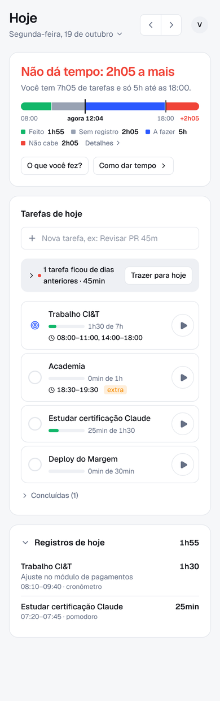

Todos os registros do dia, de todas as tarefas. Cada linha: tarefa, nota, horário · origem, tempo. **Tocar na linha edita**: tarefa, tempo/intervalo, dia, nota e 🗑 apagar (com Desfazer). Registro sem tarefa aparece com **Escolher tarefa**. O timer rodando aparece como "● rodando".

## Depois (`Later.tsx`)

| Elemento | Detalhe |
|---|---|
| Capturar | campo "Tirar da cabeça, ex: Pagar luz dia 10". Só o título vai para **Depois**; com dia no fim vira **lembrete** (com tempo, tarefa do dia). A linha embaixo diz o que vai acontecer. Enter guarda, com Desfazer |
| Depois (N) | os mais novos primeiro: círculo (concluir), nome e tempo ou "sem tempo" (tocar abre a janela da tarefa), **Hoje** (sem tempo, pede o tempo num toque), 📅 (Amanhã, Próxima segunda, Outro dia, com quanto sobra), 🗑 |
| Próximos lembretes | de hoje em diante, por data: círculo, nome, dia, **Depois** |

## Janela "O que você fez?" (`CapacityPanel.tsx`)

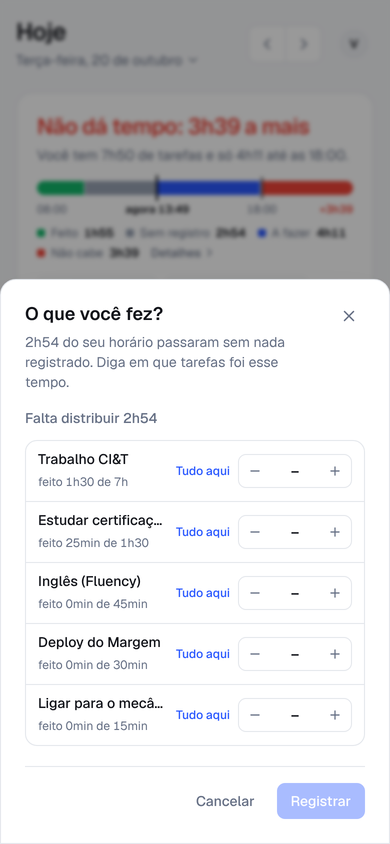

- "Falta distribuir X" / "Tudo distribuído" / "X a mais do que passou".
- Cada tarefa do dia: feito, **Tudo aqui**, − / + de 15 em 15 min.
- **Registrar X** cria um registro manual por tarefa, no dia aberto, sem horário (com Desfazer).

## Janela da tarefa (`TaskDialog.tsx`, `TimeEntries.tsx`)

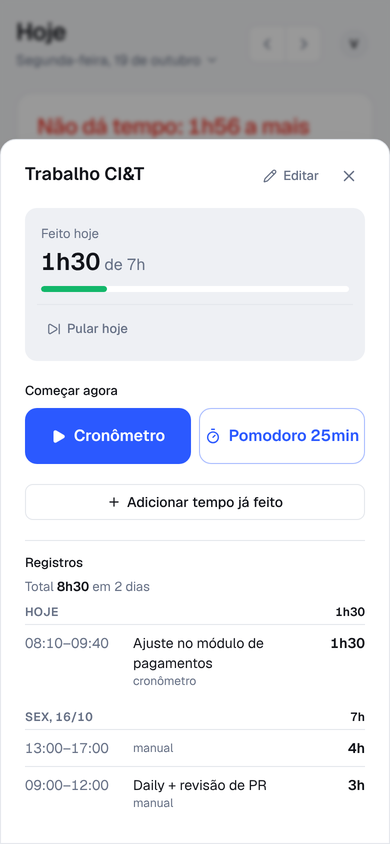

Abre ao tocar numa tarefa no Dia, em Tarefas ou na semana (aí mostra o dia da coluna tocada). **Um lugar só para a tarefa**, como no ClickUp: editar, registrar e ver os registros. Computador: detalhes à esquerda e tempo à direita. Celular: tempo primeiro, "Detalhes da tarefa" embaixo.

| Bloco | Conteúdo |
|---|---|
| Cabeçalho | nome editável (salva ao sair do campo ou Enter) · fechar |
| Detalhes | **Quando** (Uma vez: Hoje/Amanhã/Outro dia · Repete: Seg…Dom), **Quanto tempo leva** / **Meta de tempo**, **Horário** (vários, com aviso de conflito), **Como termina**. **Cada campo salva sozinho** (sem "Salvar"); erro aparece embaixo e não grava. Rodapé: **Excluir** (Desfazer) · **Desativar**/Reativar (as que repetem) · "As mudanças são salvas sozinhas." |
| Feito hoje / Feito em 18/10 | total do dia aberto, "de X", barra; "Encurtada só neste dia · Voltar ao normal" quando for o caso |
| Ações (dentro do resumo) | **Pular hoje** / Desfazer pulo (as que repetem) · **Mudar dia** (as de uma vez: Hoje, Amanhã, Próxima segunda, Outro dia) · **Concluir** / Reabrir (só "marco como feita"). Todas com aviso e Desfazer |
| Começar | **Começar cronômetro** (some se concluída ou pulada). O pomodoro fica no Foco, separado |
| Timer rodando (no lugar do anterior) | "Cronômetro rodando", relógio, "Começou às 10:16 · Mudar", **Parar** |
| Objetivos de hoje / de amanhã / Objetivos | lista para marcar o que entregar nesse tempo (ex: tickets, capítulos), "1/3", ✕ remove (Desfazer), campo "Ex: fechar ticket 123, revisar PR" (Enter adiciona). As que repetem têm uma lista por dia; as de uma vez, uma lista só. **Levar os 2 que faltam para amanhã ›** (próximo dia da tarefa, com Desfazer). Sem tempo por objetivo: não entram na conta. Para planejar amanhã: abra a tarefa pela coluna de amanhã em Tarefas › Esta semana |
| Adicionar tempo já feito | botão recolhido; aberto: 15m · 30m · 1h · 2h · campo "3h 20m ou 14:00-15:30" + **Adicionar** · Quando: Hoje / Ontem / Outro dia · Nota |
| Registros | "Total X em N dias"; por dia com total; os 3 dias mais recentes e "Mostrar mais"; tocar num registro edita tempo, dia e nota, com 🗑 para apagar (Desfazer) |

---

## Formulário da tarefa (`TaskForm.tsx`, só para criar; editar é na janela da tarefa)

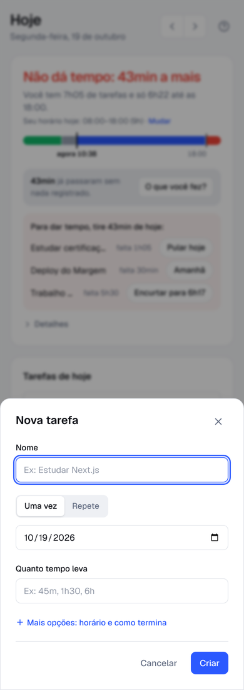 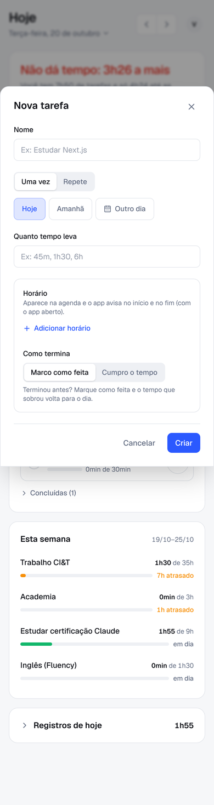 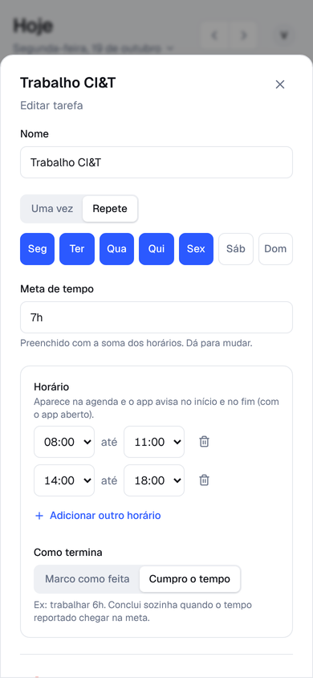

| Campo | Opções |
|---|---|
| Nome | obrigatório |
| Uma vez / Repete | Uma vez: **Hoje · Amanhã · Outro dia** (calendário) · Repete: Seg…Dom |
| Quanto tempo leva / Meta de tempo | "45m, 1h30, 6h"; obrigatório |
| Mais opções › Horário | um ou mais trechos início–fim; "Adicionar outro horário"; o tempo vira a soma; "Permitir notificações para os avisos" |
| Mais opções › Como termina | Marco como feita · Cumpro o tempo |
| Avisos | conflito de horário com outras tarefas nos próximos 14 dias (não impede salvar) |
| Erros | sem nome, sem tempo, repete sem dia, horário que termina antes de começar |
| Rodapé (editar) | **Excluir** (sem confirmação, com Desfazer; os registros ficam) · **Desativar** / Reativar (só as que repetem) · Cancelar · **Salvar** |
| Rodapé (nova) | Cancelar · **Criar** |

"Mais opções" já vem aberto quando a tarefa tem horário ou é "cumpro o tempo".

---

## Tarefas (`TasksPage.tsx`, `tasklist.ts`)

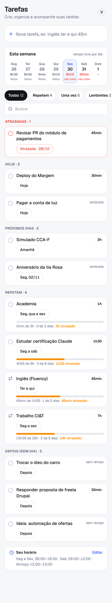

Criar, organizar e acompanhar. **Um jeito no computador, outro no celular** (arrastar no celular é ruim).

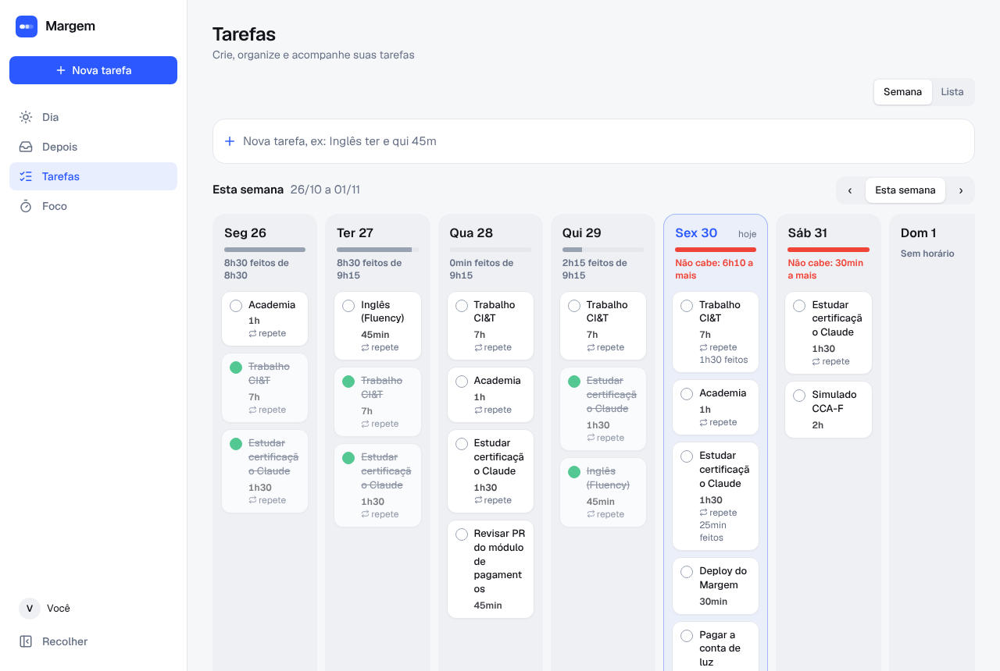

| Bloco | Conteúdo e ações |
|---|---|
| Criar (os dois) | um campo só, igual ao do Dia e do Depois: "Revisar PR amanhã 45m" (tarefa no dia), "Pagar luz dia 10" (lembrete), "Inglês ter e qui 45m" / "Academia seg a sex 1h" / "Feira toda sexta" (repete; sem tempo, 30min), "Ligar pro banco" (Depois). Embaixo, em palavras, o que vai criar; Enter cria, com Desfazer |
| **Semana** (computador) | quadro com uma coluna por dia (‹ **Esta semana** ›). Topo da coluna: barra e "2h35 de 4h20 livres" (vermelho: "Não cabe: 30min a mais"; passado: "3h feitos de 3h15"), "Agenda 7h40". Cartões na **ordem da fila do dia** (prioridade: em cima vem primeiro), depois lembretes e concluídas/puladas. **Arrastar**: no mesmo dia muda a ordem; para outro dia muda o dia (só as de uma vez; as que repetem avisam que mudam na janela). Círculo conclui; nome abre a janela. **+ Adicionar** no fim cria no dia da coluna (sem tempo abre o formulário) |
| **Lista** (computador) | filtros **Todas · Repetem · Uma vez · Lembretes · Concluídas** (14 dias) **· Desativadas** com contagem, e busca. Tabela: Tarefa (círculo; nas que repetem, conclui hoje se é dia dela, senão ícone ↻), **Quando** (de uma vez: menu de dia ali mesmo; que repete: "Seg a sex", abre a janela), **Tempo** (editável; "lembrete"; "sem tempo" em Depois), **Esta semana** (que repete: barra, "4h55 de 9h · 3 de 6 dias", "1h30 atrasado"; modo leve: só dias), **Estimado × real** (com 3+ vezes concluída com registro: "1,2× leva 1h48" ou "acerta"). Título da coluna ordena |
| Celular | faixa da semana com o número e o rótulo ("livre", "não cabe", "feitos"); tocar abre o Dia. Mesmos filtros e busca; cartões agrupados em Atrasadas, Hoje, Próximos dias, Repetem, Depois (sem dia), Concluídas, Desativadas |
| Seu horário | uma linha no fim: "Seu horário · Seg a Sex, 08:00–18:00 · … · **Editar**" |

## Seu horário (`ScheduleEditor.tsx`)

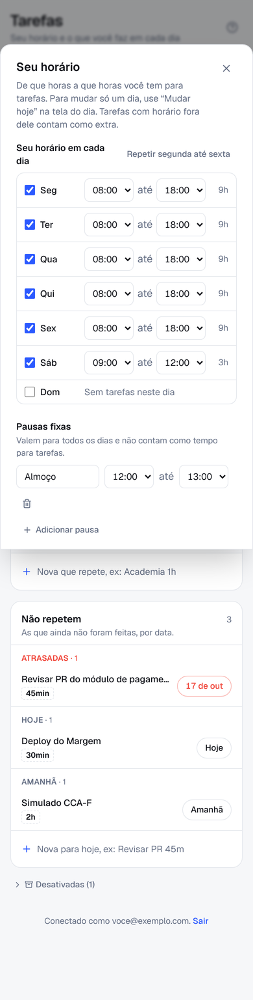

- Por dia: liga/desliga, início, fim, total do dia. Atalho **Repetir segunda até sexta**.
- Pausas fixas: nome, início, fim, remover, **Adicionar pausa**.
- "Total na semana: Xh para tarefas". **Cancelar** · **Salvar**.

---

## Foco (`FocusView.tsx`)

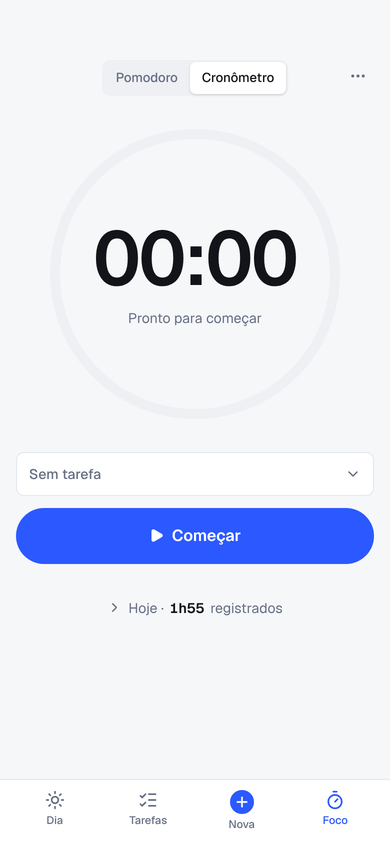 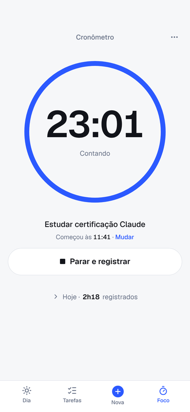

Pomodoro avulso, no estilo do Pomofocus. **Não registra tempo e não fala de tarefas.**

| Elemento | Detalhe |
|---|---|
| Tela | abas **Foco / Pausa** (trocar zera e deixa a fase pronta) e o **anel que vai se preenchendo** com o relógio (azul no foco, verde na pausa) |
| Botões | **Começar foco** / **Começar pausa** · **Pausar** · **Continuar**; ⏭ pula para a próxima fase (foco pulado não conta) |
| Embaixo | "#2 · Hora de focar!" (ou o nome da tarefa escolhida) / "Hora da pausa!", "3 pomodoros hoje", **Zerar** |
| Tarefas (lista do pomodoro) | lista própria, como no Pomofocus: círculo concluir · nome (tocar = focar nesta; aparece embaixo do "#") · **feitos / estimados** · ✎ (nome, pomodoros estimados − +, Apagar com Desfazer). **Adicionar tarefa** e, quando há tarefas de hoje fora da lista, **Importar de hoje (N)** ao lado, que abre a escolha: caixa de marcar por tarefa com "~N pomodoros"; as "extra" (fora do seu horário, ex: academia) vêm desmarcadas; as desmarcadas ficam de fora até amanhã (apagadas da lista podem voltar). Sem nada escolhido, a primeira não concluída vira a do foco; concluir a escolhida passa para a próxima. Feitos acima do estimado ficam em laranja |
| ··· da lista | **Importar tarefas de hoje (N)** (só quando há algo novo; as abertas do Dia, estimativa sugerida = tempo que falta ÷ foco + pausa; não repete) · **Limpar concluídas** · **Limpar tudo** (com Desfazer) |
| Rodapé | "Pomodoros 2/5 · Termina às 18:18 (1h30)" (não concluídas; ciclo atual) |
| ··· | foco e pausa em minutos (a fase em andamento termina com o tempo antigo; a parada já mostra o novo), início automático, avisos |

O cronômetro (que registra) aparece só na barra flutuante, também nesta tela.

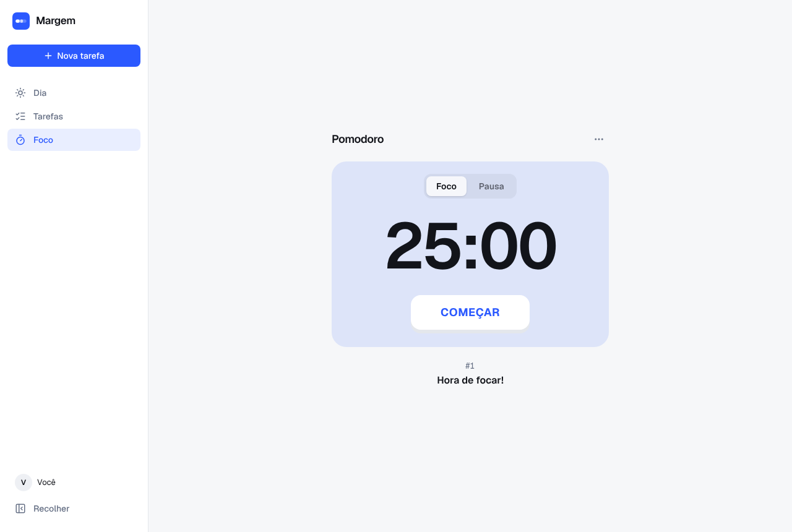

**··· Configurar pomodoro**

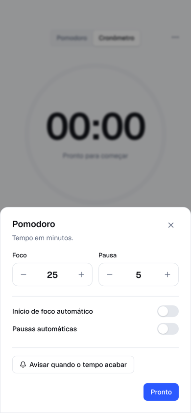

- Foco (5–180 min, passo 5) e Pausa (1–60 min).
- Início de foco automático · Pausas automáticas (desligados).
- Avisar quando o tempo acabar (permissão de notificação).

---

## Elementos globais

| Elemento | Onde | Detalhe |
|---|---|---|
| Barra do timer | flutuante | **cronômetro** (em todas as telas, com bolinha vermelha piscando): tempo, tarefa, "Começou às … · Mudar", **Parar**; tocar abre a tarefa · **pomodoro** (fora do Foco, rodando ou pausado): "Pomodoro · Foco 15:59", **Continuar** ou **Pular** |
| Avisos (toasts) (`toast.tsx`) | rodapé | confirmação (3,5s), com **Desfazer** (6s), ou erro vermelho "Não foi possível salvar" |
| Sem internet | topo | "Sem internet · salva quando voltar"; as mudanças ficam no aparelho e são enviadas quando a conexão volta |
| Avisos de horário (`SlotAlerts.tsx`) | com o app aberto | início, pausa entre horários, recomeço e fim; tolerância de 2min; não repete ao recarregar |
| Como funciona (`Onboarding.tsx › HelpDialog`) | menu da conta | os 3 passos, a régua, o que cada aba faz e dicas |

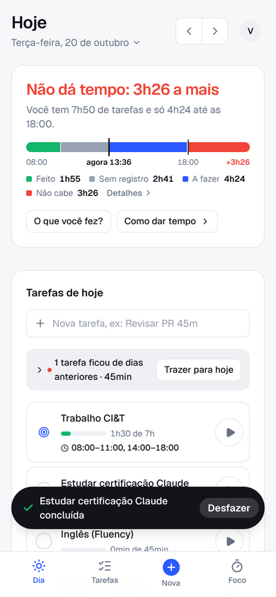 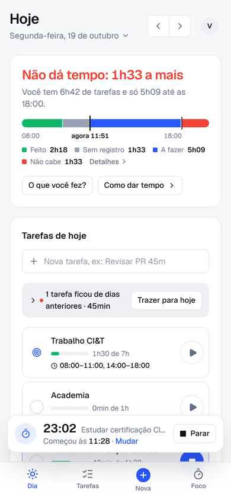 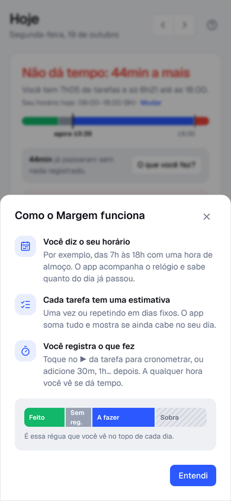
